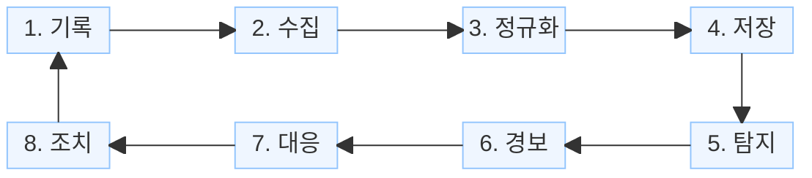
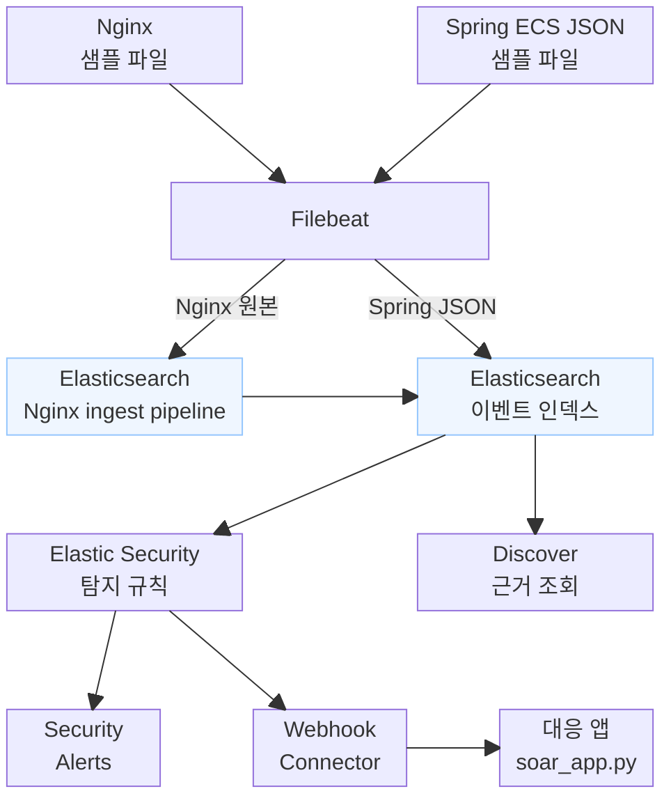

# SIEM으로 보안 모니터링 아키텍처 구성하기

10월 16일 실습에서는 보안 모니터링에 필요한 구성요소와 데이터 흐름을 구성합니다. 이전 [10월 9일 Filebeat 실습](../06_1009_observability/6.filebeat.md)에서 수집한 Nginx·Spring 로그를 기준으로 기록·수집·정규화·저장·탐지·대응·조치를 연결합니다. SIEM 경보는 대응 앱 `soar_app.py`로 전달하고, 대응 앱은 인증 앱 `auth_app.py`에 계정 차단을 요청합니다.

**데이터 엔지니어의 역할은 SIEM에서 분석하기 좋은 데이터를 준비하고, SIEM 앱이 그 데이터를 사용할 수 있도록 연결·설정하는 것입니다.** 로그를 모으는 데서 끝나지 않고, 계정·IP·시각·결과를 일관된 필드와 타입으로 저장합니다. 이어서 SIEM 앱에서 사용할 데이터, 조회 기간, 조건과 탐지 규칙을 설정하고 정상적으로 동작하는지 확인합니다.

경보 이후에는 대응 앱이 인증 앱의 계정 차단 API를 호출합니다. 로그인 실패를 확인하고, 계정 복구 API를 호출해 다시 로그인합니다.

검색·집계와 경보 확인은 준비한 데이터가 설정한 조건에 맞게 사용되는지 검증하는 과정입니다. 실제 사건의 원인·영향을 판단하고 대응하는 보안 분석 업무는 전체 구조에서 어떤 역할을 맡는지 구분합니다.

전체 흐름은 다음과 같습니다.

```text
앱·웹 서버·보안 장비의 기록
        ↓
수집·전달
        ↓
파싱·공통 필드 변환
        ↓
분석에 사용할 필드와 타입으로 저장
        ↓
SIEM 앱의 대상 데이터·조건·규칙 설정
        ↓
설정한 규칙의 실행·경보·Webhook 연결 확인
        ↓
SOAR·대응 앱을 통한 조치 요청과 조치 시스템 연결
        ↓
조치 결과 저장·확인
```

각 구성요소의 입력·출력, 배치 위치, 실패 확인 방법을 함께 정합니다.

## 1. SIEM의 개념

SIEM은 **Security Information and Event Management**, 보안 정보 및 이벤트 관리입니다. 여러 시스템에서 나온 보안 관련 로그·이벤트를 모아 검색·분석하고, 의심 행동을 탐지해 경보를 만들며 사건 조사를 지원하는 체계입니다. [Elastic의 SIEM 설명](https://www.elastic.co/what-is/siem)

웹 서버에는 요청과 응답이 남고, 애플리케이션에는 로그인 결과와 업무 처리 기록이 남을 수 있습니다. 서버에는 프로세스 실행 기록도 있습니다. SIEM은 서로 다른 기록을 연결해 의심 행동을 찾고, 경보의 근거를 조회할 수 있도록 합니다.

## 2. SIEM의 기능과 사용 목적

**OWASP(Open Worldwide Application Security Project)**는 소프트웨어 보안을 개선하기 위한 비영리 재단이자 공개 커뮤니티입니다. 보안 개발과 운영에 필요한 도구·문서·가이드를 제공합니다. [OWASP 소개](https://owasp.org/about/)

보안 로깅 지침인 **Logging Cheat Sheet**는 로그에 **언제·어디서·누가·무엇을** 기록하도록 안내하고, 행동·대상·결과·결과가 발생한 이유와 요청 정보도 추가 항목으로 제시합니다. 이 지침을 바탕으로 필요한 정보를 **5W1H 관점**에서 정리할 수 있습니다. [보안 로그의 기록 항목](https://cheatsheetseries.owasp.org/cheatsheets/Logging_Cheat_Sheet.html#event-attributes)

| 질문 | 로그에 준비할 정보 | Spring 샘플에서 확인할 예 |
|---|---|---|
| Who — 누가 | 기록된 계정·사용자·요청 주체 | 로그인에 사용한 계정 |
| What — 무엇을 | 수행한 행동, 대상과 결과 | 로그인 시도, 성공·실패, 데이터 다운로드 |
| When — 언제 | 사건이 발생한 시각 | 로그인 시각 |
| Where — 어디서 | 출발지와 대상 시스템·서비스·경로 | 접속 IP, 앱 이름, 요청 URL |
| How — 어떻게 | 요청 방식과 관측 가능한 행동 정보 | HTTP 메서드, User-Agent 등 |
| Why — 왜 | 기록할 수 있는 결과의 이유 | 인증 정보 오류, 권한 부족 등의 사유 |

**SIEM에서 사용할 로그는 이 질문에 답할 수 있도록 작성·정리합니다.** 새 로그에는 필요한 값을 기록하고, 기존 로그는 값을 추출해 공통 필드로 맞춥니다. 원본에 없는 정보는 앱 등 해당 정보를 아는 지점에서 추가로 기록해야 합니다. 기록된 실패 사유와 실제 행위자의 동기는 구분하며, 알 수 없는 값은 추측해서 채우지 않습니다.

어떤 정보를 준비할지는 감시 목적에 따라 정합니다. 반복 로그인 실패를 찾으려면 계정·IP·시각·성공 여부가 필요하고, 대량 다운로드를 찾으려면 대상·크기·횟수가 필요합니다. 데이터 엔지니어는 그 목적에 맞는 데이터를 준비하고, SIEM 앱에서 사용할 데이터·시간 범위·조건·경보 전달을 설정합니다.

### 2.1 로그가 경보와 조치로 이어지는 과정

Spring 로그에 로그인 성공·실패 기록이 있다고 가정합니다. 로그 파일을 계속 열어 보지 않아도 반복되는 실패를 알아채려면 다음 과정이 필요합니다.

| 단계 | 담당 구성요소·애플리케이션 | 하는 일 |
|---|---|---|
| 1. 기록하기 | Spring Boot 앱, Nginx | 앱은 로그인 결과 등을 기록하고, Nginx는 요청·응답을 기록합니다. |
| 2. 모으기 | Filebeat | 로그 파일을 읽어 Elasticsearch 또는 Logstash로 보냅니다. |
| 3. 항목 맞추기 | Logstash 또는 Elasticsearch ingest pipeline | 원본에서 IP·계정·시각 등을 꺼내 공통 항목으로 정리합니다. |
| 4. 보관하기 | Elasticsearch | 로그를 저장하고 계정·IP·시간으로 검색·집계할 수 있게 합니다. |
| 5. 조건 확인하기 | Elastic Security의 탐지 규칙 — Kibana에서 설정 | 사용할 데이터와 필드, 조회 기간, 그룹과 기준값을 설정합니다. 규칙이 조건을 확인하고 경보를 만듭니다. |
| 6. 알리기 | Kibana 경보 화면, Webhook Connector, FastAPI 수신 앱 | 화면에 경보를 표시하고, Connector가 외부로 전달하면 FastAPI가 받습니다. |
| 7. 조치하기 | SOAR·담당자·대응 앱 → 인증 서버·WAF·방화벽 등 | SOAR나 대응 앱이 정해 둔 절차에 따라 조치를 요청하고, 인증 서버·보안 장비 등이 계정 잠금·접속 제한을 실행합니다. |
| 8. 결과 남기기 | SOAR·대응 앱·Elasticsearch | 어떤 경보에 대해 누가 무엇을 조치했고, 성공했는지 실패했는지 기록합니다. |

**SOAR(Security Orchestration, Automation and Response)**는 여러 보안 도구를 연결하고 대응 절차를 자동화·관리하는 역할입니다. 실행 순서와 조건을 정리한 절차를 **플레이북(playbook)**이라고 하며, 정보 조회·담당자 확인·조치 요청·결과 기록을 연결합니다. **SIEM은 탐지·조사를 중심으로, SOAR는 대응 절차의 연결·자동화를 중심으로 이해하면 됩니다.** [SOAR의 역할과 SIEM과의 관계](https://www.elastic.co/what-is/soar)

**ECS**는 공통 필드의 이름·타입·의미를 정하는 규격입니다. Logstash나 Elasticsearch ingest pipeline이 이 규격에 맞춰 로그를 변환합니다.

이번 실습은 실제 앱 대신 Python 생성기로 Spring·Nginx 형식의 로그를 만듭니다. Nginx 텍스트는 ES ingest pipeline에서 변환하고, Spring JSON은 이미 ECS 항목으로 기록되어 있어 Filebeat가 JSON 속성을 읽습니다. 이 역할을 맡는 구성요소를 연결한 것이 보안 모니터링의 기본 구조입니다. 변환 규칙, 저장 타입, 전송 실패 처리 등의 설정은 각 구성요소를 연결하면서 확인합니다.

어떤 행동을 감시할지는 보안 정책과 KISA의 [보안강화 권고·사고 분석 자료](https://www.krcert.or.kr/kr/bbs/list.do?menuNo=205020&bbsId=B0000133) 등을 참고해 정합니다. 경보가 발생했다는 것은 정한 조건에 맞았다는 뜻이며, 실제 계정 부정 사용인지는 관련 로그를 추가로 확인합니다.


필요한 값을 목록으로 정리하고, 해당 값이 실제 소스에 기록되는지 확인합니다.

| 보호 대상·엔티티 | 알고 싶은 사실 | 필요한 기록 |
| --- | --- | --- |
| 계정 | 누가 어떤 계정으로 인증을 시도했나? | 계정 이름, 결과, 실패 이유, 시각 |
| 접속 IP | 어느 출발지에서 시도가 집중됐나? | 요청 출발지, 시각, 서비스 |
| HTTP 요청 | 어느 경로에 어떤 요청을 보냈나? | URL, 메서드, 응답 코드 |
| 고객 데이터 | 어떤 계정이 어떤 데이터를 얼마나 가져갔나? | 접근·export 이벤트, 대상, 결과, 건수·크기 |
| 서버 | 이후 어떤 프로세스나 파일 활동이 있었나? | 프로세스·파일·네트워크 이벤트 |

먼저 실제로 기록되는 항목을 확인합니다. 없는 항목은 개발·운영팀과 로깅 요구사항을 정하거나, 인증 서버·보안 장비 등 다른 소스에서 확보해야 합니다. 애플리케이션은 계정·권한·업무 결과에 대한 정보를 알고 있으므로 감사 이벤트를 설계하는 중요한 위치입니다.

### 2.3 ECS와 SIEM의 역할

ECS는 기록된 사실을 함께 읽을 수 있도록 필드 이름·타입·의미를 맞추는 규격입니다. 예를 들어 계정은 `user.name`, 출발지는 `source.ip`, 사건 시각은 `@timestamp`, 행동과 결과는 `event.action`·`event.outcome`에 대응시킬 수 있습니다. 육하원칙으로 필요한 정보를 정리한 뒤, 원본 값의 의미에 맞는 ECS 필드를 선택합니다. [ECS 필드 참조](https://www.elastic.co/guide/en/ecs/8.17/ecs-field-reference.html)

SIEM은 이렇게 정리한 사실을 검색·연결·분석해 의심 조건을 탐지하고 조사를 지원합니다. **감시 목적과 판단 기준은 사람이 설계하고, ECS는 데이터의 표현을 맞추며, SIEM은 그 데이터를 분석합니다.**

### 2.4 RDB에서 배운 명세서가 로그에서도 필요한 이유

RDB에서 테이블을 만들 때 컬럼 이름과 타입을 정합니다. 그런데 `status`를 문자열로 저장한다는 정보만으로는 값의 뜻을 알 수 없습니다. 주문 서비스의 `completed`는 결제가 끝났다는 뜻일 수 있고, 배송 서비스의 `completed`는 상품이 도착했다는 뜻일 수 있습니다. 두 값을 같은 “완료”로 묶으면 아직 배송되지 않은 주문도 배송 완료 건수에 포함될 수 있습니다.

그래서 메타데이터 명세서와 도메인 명세서를 함께 작성합니다. 메타데이터 명세에는 컬럼·타입·형식·단위·누락 허용 여부 등을 기록하고, 도메인 명세에는 그 데이터가 나타내는 업무 개념과 값의 의미·판단 규칙을 기록합니다.

| 명세할 내용 | RDB의 예 | 로그·이벤트의 예 |
|---|---|---|
| 항목의 이름과 타입 | 주문 상태 컬럼, 문자열 | 인증 결과 필드, `keyword` |
| 값의 의미 | 완료가 결제 완료인지 배송 완료인지 | 성공이 HTTP 응답 성공인지 인증 성공인지 |
| 단위와 시각 기준 | 금액의 통화, 주문 생성 시각 | 처리 시간의 단위, 사건 발생 시각과 수집 시각 |
| 허용 값과 누락 처리 | 주문 상태 코드, 값이 없는 경우의 처리 | 결과 코드, 계정·IP를 모르는 경우의 처리 |
| 생성 기준과 책임 | 어느 서비스가 상태를 변경하는가? | 어느 앱·장비가 사건과 결과를 기록하는가? |

로그에서도 같은 문제가 발생합니다. 어떤 앱은 접속 IP를 `clientIp`로, 다른 앱은 `src_ip`로 기록합니다. 이름을 맞추더라도 한 값은 사용자의 IP이고 다른 값은 중간 프록시의 IP라면 의미가 다릅니다. HTTP 200을 인증 성공으로 취급할 수 있는지도 앱의 동작을 확인해야 합니다. **필드 이름을 바꾸기 전에, 그 값이 어떤 사실을 나타내는지 합의해야 합니다.**

### 2.5 ECS와 OpenTelemetry의 발전 과정

**ECS는 Elastic 생태계에서 여러 소스의 데이터를 같은 의미로 읽기 위한 공통 규약**입니다. **OpenTelemetry는 여러 벤더가 함께 사용하는 관측 데이터의 공통 기반**이며, 그중 Semantic Conventions가 속성의 이름과 의미를 정합니다. [Semantic Conventions](https://opentelemetry.io/docs/concepts/semantic-conventions/)

| 시점 | 주요 변화 |
|---|---|
| 2019년 4월 | [ECS 1.0 공개](https://ir.elastic.co/News--Events/news/news-details/2019/Elastic-Introduces-Elastic-Common-Schema-ECS-to-Enable-Uniform-Data-Modeling/default.aspx): 서로 다른 로그를 공통 필드로 정리 |
| 2019년 5월 | [OpenTelemetry 출범](https://www.cncf.io/blog/2019/05/21/a-brief-history-of-opentelemetry-so-far/): OpenTracing과 OpenCensus를 통합 |
| 2020~2021년 | Elastic이 [OpenTelemetry 연동](https://www.elastic.co/blog/whats-new-elastic-observability-7-9-0-unified-agent-kpi-overview-dashboard/)과 [네이티브 수신](https://www.elastic.co/blog/whats-new-elastic-observability-7-13-0)을 지원 |
| 2023년 4월 | [ECS와 Semantic Conventions 수렴 추진](https://opentelemetry.io/blog/2023/ecs-otel-semconv-convergence/): 데이터의 의미 규약까지 공통 기준으로 맞추는 협력 |

두 규약 모두 Apache 2.0으로 공개되어 있으며, 공통 의미 규약으로 수렴하는 협력이 진행되고 있습니다. [ECS와 OpenTelemetry의 관계](https://www.elastic.co/docs/reference/ecs/ecs-opentelemetry), [라이선스 설명](https://www.elastic.co/blog/ecs-elastic-common-schema-otel-opentelemetry-faq/)

기존 Elastic APM은 OpenTelemetry 데이터를 수신한 뒤 ECS·APM 필드로 매핑합니다. 예를 들어 `deployment.environment`를 `service.environment`로 대응시킵니다. [Elastic 8.19 매핑 예](https://www.elastic.co/guide/en/observability/8.19/apm-open-telemetry-resource-attributes.html)

이 역사에서도 RDB와 같은 원칙을 확인할 수 있습니다. **메타데이터·도메인 명세로 값의 의미를 합의하고, 그 명세를 변환·저장·분석 설정에 반영해야 합니다.**

## 3. 보안 모니터링에 필요한 역할

보안 모니터링에 필요한 역할을 **ELK 계열**과 **LGTM 스택**으로 나누어 비교합니다. 두 구성 모두 감시 목적과 필요한 기록을 먼저 정하고, 각 역할을 맡을 구성요소를 연결합니다.

- **ELK**: Elasticsearch·Logstash·Kibana입니다. 아래 비교에는 함께 사용하는 Filebeat·Metricbeat와 Elastic Security도 포함합니다.
- **LGTM**: Loki·Grafana·Tempo·Mimir입니다. Loki는 로그, Tempo는 요청의 처리 흐름을 나타내는 트레이스, Mimir는 수치 지표를 저장하고 Grafana는 조회·시각화·경보 화면을 제공합니다. 로그 수집기인 Alloy를 함께 구성할 수 있습니다. [Grafana 스택 소개](https://grafana.com/about/grafana-stack/)

### 3.1 역할별 구성요소 비교

| 역할 | 해야 하는 일 | ELK 계열 | LGTM 스택 |
|---|---|---|---|
| 기록하기 | 앱·서버에서 발생한 사실을 로그로 남김 | Spring 감사 로그, Nginx access 로그 등 | 같은 앱·서버의 로그 사용 |
| 로그 모으기 | 파일·컨테이너 등의 로그를 읽어 전달 | Filebeat | Grafana Alloy의 로그 수집 기능 |
| 메트릭 모으기 | CPU 사용률·요청 수 등의 수치 지표 수집 | Metricbeat | Prometheus, 또는 Alloy의 메트릭 수집 기능 |
| 항목 맞추기 | 원본에서 값을 꺼내 공통 항목으로 정리 | Logstash 또는 Elasticsearch ingest pipeline | Alloy의 `loki.process` 등 처리 단계 |
| 공통 항목 정하기 | 서비스·요청·사용자 등의 정보에 공통 이름과 의미를 부여 | ECS를 기준으로 필드·타입 설계 | OpenTelemetry의 Semantic Conventions를 기준으로 속성 설계 가능, Loki 라벨·추가 정보 배치 설계 |
| 로그 보관하기 | 로그를 저장하고 검색할 수 있게 함 | Elasticsearch | Loki |
| 메트릭 보관하기 | 수치 지표를 시간에 따라 저장 | Elasticsearch | Prometheus의 자체 저장소, 중앙 보관이 필요하면 Mimir에 전송 |
| 조회·확인하기 | 저장된 값과 검색·집계 결과를 확인 | Kibana Discover·Dashboard | Grafana Explore·Dashboard, Loki의 LogQL 검색 |
| 조건 확인하기 | 횟수·시간 등의 기준을 규칙으로 설정 | Elastic Security 탐지 규칙 | Grafana Alerting — Loki 로그에서 횟수 등을 계산한 결과로 조건 설정 |
| 알리기 | 경보를 화면에 표시하고 외부로 전달 | Kibana 경보 화면·Webhook Connector | Grafana 경보 화면·Webhook Contact point |
| 조치하기 | 플레이북에 따라 필요한 확인·승인과 외부 시스템의 조치 요청을 연결 | 연동한 SOAR 또는 대응 앱 → 인증 서버·WAF·방화벽 | 연동한 SOAR 또는 대응 앱 → 인증 서버·WAF·방화벽 |
| 결과 남기기 | 경보와 조치 내용·성공 여부를 연결해 보관 | SOAR·대응 앱 → Elasticsearch | SOAR·대응 앱의 조치 이력은 로그로 Loki에 보관 가능, 수정할 업무 상태는 별도 DB·업무 앱으로 관리 |

로그 모니터링의 주요 구성은 **Alloy → Loki → Grafana**입니다. 트레이스를 함께 다루면 Tempo를, 메트릭을 중앙에서 보관하면 Mimir를 연결합니다.

**Prometheus는 수치 지표인 메트릭을 수집·저장하고 조회하는 도구입니다.** 로그 파일을 읽어 Loki로 보내는 역할은 Alloy 같은 로그 수집기가 맡습니다. Alloy도 메트릭을 수집할 수 있지만, 여기서는 로그 수집과 메트릭 수집을 나누어 비교합니다. [Prometheus의 역할](https://prometheus.io/docs/introduction/overview/), [Metricbeat의 역할](https://www.elastic.co/guide/en/beats/metricbeat/8.19/metricbeat-overview.html)

```text
로그:   앱 로그 → Alloy → Loki → Grafana
메트릭: 앱·서버의 수치 지표 → Prometheus → Grafana
        중앙 메트릭 보관을 구성하면 Prometheus → Mimir → Grafana
```

Prometheus의 `remote_write`를 사용하면 수집한 메트릭을 Mimir로 전달할 수 있습니다. Mimir는 메트릭을 중앙에서 보관·조회할 때 사용하는 구성요소이며, Grafana와 Prometheus만으로도 메트릭 모니터링을 구성할 수 있습니다. [Prometheus에서 Mimir로 전달](https://grafana.com/docs/mimir/latest/send/)

**ECS와 OpenTelemetry의 Semantic Conventions는 데이터 항목의 이름과 의미를 정하는 역할로 비교합니다.** OpenTelemetry는 데이터의 기록·수집·전달을 다루며, 그중 Semantic Conventions가 로그·지표·트레이스 등의 공통 속성을 정의합니다. 두 규약을 연결할 때는 원본 속성의 의미와 저장할 필드를 기준으로 대응 관계를 정합니다. [Semantic Conventions](https://opentelemetry.io/docs/concepts/semantic-conventions/)

공식 자료: [Alloy 로그 수집·전달](https://grafana.com/docs/loki/latest/send-data/alloy/), [로그 처리 단계](https://grafana.com/docs/alloy/latest/reference/components/loki/loki.process/), [Grafana Alerting](https://grafana.com/docs/grafana/latest/alerting/), [Webhook 알림](https://grafana.com/docs/grafana/latest/alerting/configure-notifications/manage-contact-points/integrations/webhook-notifier/)

### 3.2 데이터 준비와 앱 설정의 차이

ELK 계열에서는 ECS 필드와 Elasticsearch 매핑을 맞추고, Kibana에서 사용할 데이터와 탐지 규칙을 설정합니다. LGTM에서는 OpenTelemetry를 활용할 경우 Semantic Conventions에 맞춰 속성을 준비하고, Loki의 라벨·추가 정보 배치를 정한 뒤 Grafana에서 데이터 소스·조회 조건·경보 규칙을 설정합니다. 일반 JSON 로그를 수집하는 구성에서는 로그 필드의 이름·의미를 직접 맞출 수도 있습니다.

이번 실습은 ELK 구성으로 로그 수집·변환·탐지 규칙을 연결합니다.

Loki 라벨은 서비스·환경처럼 값의 종류가 적은 항목에 사용합니다. 계정·IP·요청 ID처럼 값이 계속 늘어나는 항목은 JSON 본문이나 추가 정보인 structured metadata에 배치합니다. [Loki 라벨 설계](https://grafana.com/docs/loki/latest/get-started/labels/)

Elastic Security는 보안 탐지·조사·사건 관리 기능을 제공합니다. LGTM 기본 구성은 로그·지표·트레이스의 수집·조회·경보에 사용하는 관측성 스택입니다. 로그를 이용한 보안 모니터링을 구성할 수 있지만, 보안 전용 탐지·사건 관리 기능이 필요하면 별도 SIEM이나 업무 앱과의 연결을 설계합니다.

두 구성 모두 Webhook 이후에 SOAR 또는 대응 앱을 연결해 조치 절차를 구성할 수 있습니다. 실제 계정 잠금·접속 제한은 연동한 인증 서버·보안 장비 등이 실행합니다. 전달되는 경보 JSON의 형식도 다르므로 수신 측은 각 형식에 맞게 값을 읽고, 경보 식별 정보·조치 대상·처리 결과를 공통 구조로 정리합니다.

이번 실습은 ELK 계열로 진행합니다. LGTM은 같은 역할을 다른 구성요소로 구현하는 비교 자료로 사용합니다.

## 4. 구성요소와 데이터 흐름

앱·서버·보안 장비에서 남긴 기록을 수집·정규화해 저장하고, 탐지 조건에 맞으면 경보를 만듭니다. 경보를 확인해 대응 절차를 진행하고 실제 조치를 실행하면, 그 결과도 새로운 기록으로 남아 다시 수집됩니다.

용어는 다음과 같이 통일합니다. **정규화**는 원본을 파싱해 필드 이름·타입·표현을 공통 기준으로 맞추는 과정입니다. **대응**은 경보의 근거 확인·조사·판단과 실행할 절차의 관리를, **조치**는 계정 잠금·접속 제한 등의 실제 실행을 뜻합니다.

이 흐름에서 SIEM 제품은 수집·정규화·저장·탐지·조사 중 여러 기능을 묶어 제공할 수 있습니다. SOAR 기능도 SIEM 제품에 통합되거나 별도 솔루션으로 연동될 수 있습니다. 차단·권한 제어까지 어디서 수행할지는 연동 구성에 따라 다릅니다. ECS는 공통 필드 변환과 분석에서 참고하는 규격입니다.

기본 Nginx 로그에는 요청·응답 정보가 있지만, 애플리케이션이 판단한 로그인 계정·결과가 충분히 들어 있지 않을 수 있습니다. 수집기는 존재하는 기록을 전송하고, 파서는 기록된 값을 추출합니다. 부족한 업무 정보는 기록하는 지점에서 확보합니다.

### 4.1 연결별 입력과 출력

기록을 시작으로 시계 방향으로 읽습니다. 조치 결과는 다시 기록되어 수집되며, 각 연결에서 주고받는 데이터는 아래 표에 정리합니다.



| 연결 | 주고받을 데이터 | 설계할 내용 |
| --- | --- | --- |
| 기록 → 수집 | 원본 로그·이벤트, 소스 식별 정보 | 형식·경로·인코딩, 로그 회전, 읽기 권한 |
| 수집 → 정규화 | 원본과 발생 시각·수집 메타데이터 | 전달 경로, 전송 실패 시 재시도·버퍼, 지연 확인 |
| 정규화 → 저장 | 공통 필드로 정리한 이벤트 | 필드 의미·타입, 원본 보존, 누락·파싱 실패 처리, 정규화 규칙 버전 |
| 저장 → 탐지 | 검색·집계할 이벤트 | 대상 데이터셋, 사건 시각, 조회 구간·실행 주기, 지연·중복 고려 |
| 탐지 → 경보 | 규칙·일치한 조건·발생 시각·근거 | 경보 생성 기준, 경보 ID, 심각도, 근거 이벤트와의 연결 |
| 경보 → 대응 | 경보 ID·규칙·조치 대상·근거 또는 근거 조회 정보 | payload 형식, 인증, 전달 실패·재전송·중복 처리, 담당자·플레이북 연결 |
| 대응 → 조치 | 대상·실행할 조치·판단 근거·요청 ID | 필요한 승인, 실행 권한, 호출할 시스템과 API |
| 조치 → 기록 | 조치 실행 결과와 이후 활동의 새로운 로그·이벤트 | 결과를 기록할 시스템, 경보·요청 ID와의 연결, 실패 여부와 실행 시각 |

ECS는 이벤트 데이터의 표현 기준입니다. 정규화 레이어는 그 기준에 맞춰 원본을 파싱·변환하는 실행 구성요소입니다. Elasticsearch 매핑은 저장된 필드의 타입과 검색 동작을 정합니다. 세 역할을 구분해 입력·출력을 확인합니다.

### 4.2 구성요소의 배치 위치

수집기는 소스에 접근할 수 있는 위치에 둡니다. 정규화는 Logstash·별도 코드·ES ingest pipeline 중 운영과 검증이 가능한 위치에서 수행합니다. 수집·정규화·저장·탐지·경보·대응·조치를 연결할 인증 정보와 권한, 네트워크 접근 범위를 정합니다.

버퍼나 메시지 큐는 데이터량·복구 시간·유실 허용 범위에 따라 선택합니다. 이번 실습에서는 단순한 흐름으로 시작하고, 운영 환경에서는 수집 중단·정규화 실패·색인 실패·경보 전달 실패를 각 단계의 입력·출력과 오류 기록으로 확인하도록 설계합니다.

## 5. SIEM 플랫폼 비교

| 플랫폼 | 주요 역할 | 참고 |
| --- | --- | --- |
| Elastic Security | Elastic Stack의 데이터를 기반으로 탐지·조사·사건 관리 | [SIEM 개요](https://www.elastic.co/what-is/siem) |
| Splunk Enterprise Security | 수집된 데이터의 보안 분석·탐지·조사와 대응 흐름 | [제품 안내](https://www.splunk.com/en_us/products/enterprise-security.html) |
| Microsoft Sentinel | 커넥터·정규화·분석 규칙·사건 조사·대응 연동을 제공하는 클라우드 SIEM | [제품 개요](https://learn.microsoft.com/en-us/azure/sentinel/overview) |
| Wazuh | 에이전트와 중앙 구성으로 로그 분석·호스트 보안 모니터링 등 SIEM·XDR 기능 제공 | [구성 요소](https://documentation.wazuh.com/current/getting-started/components/index.html) |
| OpenSearch Security Analytics | 로그 소스·필드 대응·탐지·경보와 소스 사이의 상관분석 | [기능 안내](https://docs.opensearch.org/latest/security-analytics/) |

플랫폼을 비교할 때는 수집기, 변환 규칙, 저장소, 탐지 규칙, 조사 화면의 위치와 연결 방식을 확인합니다. 각 플랫폼의 공통 데이터 규격과 필드 대응 방식을 확인하고, 이번 Elastic 실습에서는 ECS를 기준으로 데이터를 준비합니다.

## 6. 실습 환경의 구성

| 역할 | 이번에 사용하는 구성 | 확인할 내용 |
| --- | --- | --- |
| 기록 | Python이 만든 Nginx·Spring 샘플 | 합성 로그라는 전제, 원본에 실제로 들어 있는 값 |
| 수집 | Filebeat | 파일 경로, 읽은 위치, 전송 결과 |
| 정규화 | Nginx 모듈의 ingest pipeline, ECS 이름으로 작성된 Spring JSON | 원본 → 필드 대응, 변환 규칙과 입력·출력 |
| 공통 규격 | ECS | IP·계정·사건 분류·결과의 의미와 타입 |
| 저장·검색 | Elasticsearch | 매핑, 검색 조건, 시간 범위, 집계 |
| 탐지 | Elastic Security의 Threshold 규칙 | 같은 IP·계정의 실패 횟수와 조회 기간 |
| 조사 | Security Alerts, Discover | 경보 조건과 원본 이벤트의 근거 |
| 전달 | Webhook Connector | 경보 JSON 전송과 실제 수신 |
| 대응 | `soar_app.py` | 경보 수신·검증, 인증 앱에 계정 차단 요청 |
| 조치 | `auth_app.py` | `admin` 계정의 로그인·차단·복구 |
| 결과 확인 | 대응 앱 터미널·API 응답 | 수신한 경보 JSON, 계정 차단 결과, 로그인 성공·실패 |

Spring 샘플은 계정·인증 결과 등의 감사 정보를 ECS 필드로 기록합니다. 실제 앱에서는 필요한 감사 이벤트를 기록하고, 기존 로그에서 해당 값을 추출해 ECS 필드로 변환합니다.

Nginx 모듈도 입력 형식과 결과를 확인해야 합니다. 제공되는 규칙을 읽고 샘플 입력을 시험한 뒤 사용합니다. 직접 작성하는 변환 코드·규칙 역시 정상·누락·잘못된 값의 예상 출력, 실패 처리, 변경 이력을 관리합니다.

### 6.1 Filebeat와 Elasticsearch 연결

Filebeat는 Nginx·Spring 로그를 읽어 Elasticsearch로 전달합니다. Nginx 로그는 ingest pipeline에서 ECS 필드로 변환하고, Spring 로그는 생성 단계에서 ECS 필드로 작성합니다. 파란 두 박스는 Elasticsearch 내부의 처리·저장 역할을 나타냅니다.




### 6.2 경보 수신과 처리 범위

대응 앱 `soar_app.py`는 경보를 수신·검증하고 터미널에 출력합니다. 인증 앱 주소를 연결하면 `high`·`critical` 경보에 대해 `auth_app.py`의 `/block`을 호출합니다. [인증 앱 실습](2.auth-app.md)에서는 차단 후 로그인 실패와 `/unblock`을 통한 복구를 확인합니다.

### 6.3 SIEM 앱에서 데이터를 사용하는 설정

분석에 사용할 데이터를 준비한 뒤, Kibana의 Elastic Security에서 그 데이터를 읽는 규칙을 설정합니다.

| 설정할 항목 | 이번 실습의 설정 | 확인할 내용 |
|---|---|---|
| 사용할 데이터 | 인덱스 패턴 `filebeat-*`, `event.dataset`은 `spring.application` | 준비한 Spring 로그가 대상에 포함되는가? |
| 사용할 필드와 조건 | `event.category: authentication`, `event.outcome: failure` | 인증 실패가 일관된 값으로 저장돼 조건에 검색되는가? |
| 묶어서 셀 항목 | `source.ip`, `user.name` | IP와 계정이 누락되지 않고 그룹별 집계에 사용되는가? |
| 조회 기간과 실행 주기 | 최근 6분을 조회하고 1분마다 실행 | 사건 시각이 올바르고 수집 지연 때문에 대상에서 빠지지 않는가? |
| 경보 기준 | 같은 IP·계정의 실패 10회 이상 | 지정한 필드·기간·기준으로 경보가 생성되는가? |
| 외부 연결 | Webhook Connector → FastAPI | 경보 데이터가 정한 형식으로 전달·수신되는가? |

위 값은 설정 과정을 확인하기 위한 실습 기준입니다. 운영 기준은 보안 요구사항에 맞춰 정합니다. 필드와 타입은 이전 [Filebeat 실습](../06_1009_observability/6.filebeat.md)의 수집 결과에서 확인합니다. 규칙·Connector·Actions는 [Kibana SIEM 설정](1.kibana-siem.md), 대응 앱과 인증 앱의 실행·요청은 [인증 앱 실습](2.auth-app.md)에서 진행합니다.

### 6.4 경보 이후의 SOAR·조치 연결

운영 환경의 대응 절차는 SOAR의 플레이북이나 직접 구현한 대응 앱으로 구성할 수 있습니다. 예를 들어 반복 로그인 실패 경보를 받으면 대상 계정·IP를 확인하고, 정해 둔 정책에 따라 담당자 승인을 거쳐 접속 제한을 요청한 뒤 결과를 기록합니다. [Splunk SOAR의 플레이북·도구 연동 예](https://www.splunk.com/en_us/products/splunk-security-orchestration-and-automation.html)

```text
SIEM 경보
    ↓
Webhook → SOAR 또는 대응 앱에서 경보 수신
    ↓
플레이북에 따라 대상 확인·추가 정보 조회
    ↓
정책에 따른 자동 실행 또는 담당자 승인
    ↓
조치 시스템의 API 호출
    ↓
인증 서버의 계정 잠금 / WAF·방화벽의 접속 제한 등
    ↓
조치 결과를 Elasticsearch에 저장
```

| 연결 | 필요한 데이터 | 확인할 내용 |
|---|---|---|
| 경보 → SOAR·대응 앱 | 경보 ID, 규칙, 조치 대상 | 어느 경보에 대한 요청인지, 대상 계정·IP가 확보됐는지 확인합니다. |
| SOAR·대응 앱 → 조치 시스템 | 대상, 수행할 조치, 요청 ID | 플레이북에 정한 조건·필요한 승인·실행 권한을 확인하고 올바른 시스템에 요청합니다. |
| 조치 시스템 → 결과 저장 | 요청 ID, 조치 대상·내용, 실행 시각, 성공·실패, 오류 내용 | 조치 결과를 경보와 연결해 저장하고 실패를 확인합니다. |

SOAR는 대응 절차와 도구 연동을 관리하는 개념으로 소개합니다. 실습의 대응 앱 `soar_app.py`는 경보를 받아 인증 앱에 조치를 요청하는 역할을 맡습니다. `high`·`critical` 경보를 받으면 `auth_app.py`의 `/block`을 호출하고, 인증 앱은 Spring 샘플과 같은 `admin` 계정을 차단합니다. [인증 앱 실습](2.auth-app.md)에서 `/login`과 `/unblock`으로 차단·복구 결과를 확인합니다.

### 6.5 실습 순서

| 순서 | 자료 | 역할과 실습 내용 |
|---|---|---|
| 1 | [Kibana SIEM 설정](1.kibana-siem.md) 실습 준비~2절 | Kibana 암호화 키 설정·재시작, Trial·권한 확인, Filebeat 실행·최신 샘플 로그 수집, Threshold 규칙 생성·Security Alerts 확인 |
| 2 | [인증 앱과 대응 앱](2.auth-app.md) 1~4절 | 앱 실행·수신 확인, 로그인·계정 차단·복구 API 호출 |
| 3 | [Kibana SIEM 설정](1.kibana-siem.md) 4~7절 | Connector·Actions 설정, 실제 경보 전송 |
| 4 | [인증 앱과 대응 앱](2.auth-app.md) 5절 | 실제 경보에 따른 계정 차단·복구 확인 |

### 6.6 Filebeat·로그 생성기·앱 실행

먼저 [Kibana 암호화 키 설정](1.kibana-siem.md#실습-준비-kibana-암호화-키-설정)과 Trial·권한 확인을 마칩니다.

로그 생성기와 앱은 `2609_kookmin_rag` 저장소 루트에서 실행합니다. 이 위치에서 `06_1009_observability`·`07_1016_SIEM` 폴더가 바로 보입니다. Filebeat는 설정 파일이 있는 설치 폴더에서 실행합니다.

터미널 1 — Filebeat 설치 폴더에서 수집 실행:

```sh
./filebeat -e
```

이 터미널은 전체 실습 동안 유지합니다. 설치 폴더 이동과 설정·연결 검사는 [Kibana SIEM 자료의 실습 준비](1.kibana-siem.md#준비-1-filebeat-실행)에 따라 진행합니다.

터미널 2 — 저장소 루트에서 최신 샘플 로그 추가:

[공통 로그 생성기](../06_1009_observability/generate_sample_logs.py)로 현재 시각 기준 최근 1분의 SIEM 로그를 추가합니다. Windows·Mac 공통 명령이며, `--append`로 Filebeat가 읽는 `06_1009_observability/logs`의 기존 파일 뒤에 기록합니다. 규칙·Actions 설정을 마친 직후에도 같은 명령으로 새 로그를 추가해 탐지·전송을 확인합니다.

```sh
uv run --no-project ./06_1009_observability/generate_sample_logs.py --scenario siem --minutes 1 --append --output-dir ./06_1009_observability/logs
```

앱도 저장소 루트에서 실행합니다. Windows·Mac에서 같은 명령을 사용하며, `uv`가 스크립트에 선언된 패키지를 준비합니다.

터미널 3 — 인증 앱:

```sh
uv run --script "./07_1016_SIEM/auth_app.py"
```

터미널 4 — 대응 앱과 인증 앱 연결:

```sh
uv run --script "./07_1016_SIEM/soar_app.py" --login-url http://127.0.0.1:8082
```

| 앱 | API 문서 | 확인할 동작 |
|---|---|---|
| 인증 앱 | `http://127.0.0.1:8082/docs` | `admin` / `1234` 로그인, `/block`·`/unblock` |
| 대응 앱 | `http://127.0.0.1:8081/docs` | `/webhook/siem` 경보 수신과 인증 앱의 차단 결과 |

## 7. 아키텍처 구성 확인

실습 구성에서 다음 항목을 확인합니다.

| 설계 결과 | 이번 실습에서 확인할 것 |
| --- | --- |
| 구성도 | 소스 → Filebeat → 변환·ES 저장 → 탐지 → 경보·Webhook → FastAPI의 연결 |
| 책임 구분 | 계정·인증 결과는 기록 지점, 전송은 수집기, 필드 대응은 변환 규칙, 판단은 탐지 규칙이 맡음 |
| 필드 대응표 | 원본 값, 공통 필드, 저장 타입, 값이 없거나 잘못됐을 때의 처리 |
| 연결별 입력·출력 | 원본 한 건, 정규화된 이벤트 한 건, 경보 payload 한 건을 대응시킴 |
| 운영 확인 방법 | 수집 지연, 변환 실패, 색인 실패, 규칙 실행 결과, Webhook 수신 결과를 어디서 확인하는가 |
| 대응 범위 | 대응 앱이 차단을 요청하고, 인증 앱이 계정 상태를 변경하며, 로그인 결과로 확인함 |

제품 이름을 바꿔도 각 역할과 연결이 설명되는지 확인합니다. 직접 만든 변환 코드도 입력·출력·오류 처리·운영 담당자가 있는 구성요소로 설계합니다.

## 8. 실습 완료 확인

- [ ] 기록·수집·변환·저장·탐지·경보 전달의 연결을 확인했습니다.
- [ ] 각 구성요소의 입력과 출력을 구분했습니다.
- [ ] 원본에 없는 값을 확보할 기록 위치를 확인했습니다.
- [ ] ECS 규격, 변환 규칙, Elasticsearch 매핑의 역할을 구분했습니다.
- [ ] 계정·IP·시각·결과·로그 종류가 분석에 사용할 필드와 타입으로 저장됐습니다.
- [ ] SIEM 앱에서 대상 데이터·필드·조회 기간·탐지 규칙을 설정하고 실행 결과를 확인했습니다.
- [ ] 수집 지연·변환 실패·색인 실패·경보 전달 실패의 확인 위치를 정했습니다.
- [ ] 대응 앱의 경보 수신과 인증 앱의 계정 차단을 확인했습니다.
- [ ] 차단 후 로그인 실패와 계정 복구 후 로그인 성공을 확인했습니다.

## 9. 다음 실습

다음 수업은 [10월 23일 전반기 종합 실습](../07_1023_integrated_lab/README.md)입니다.
