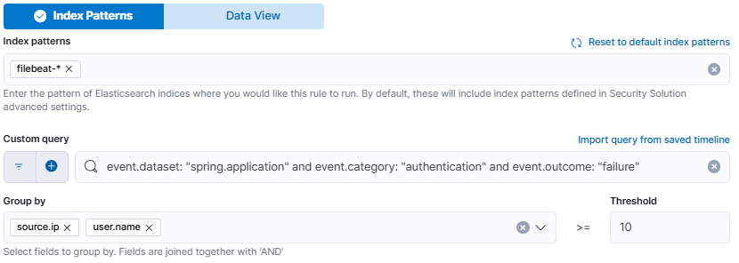
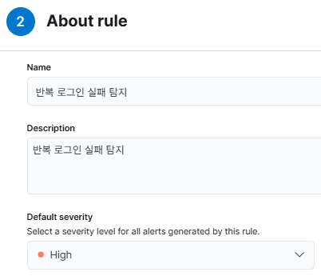
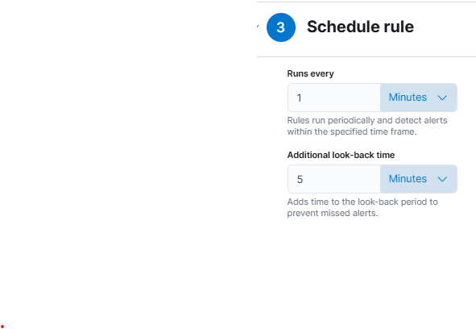
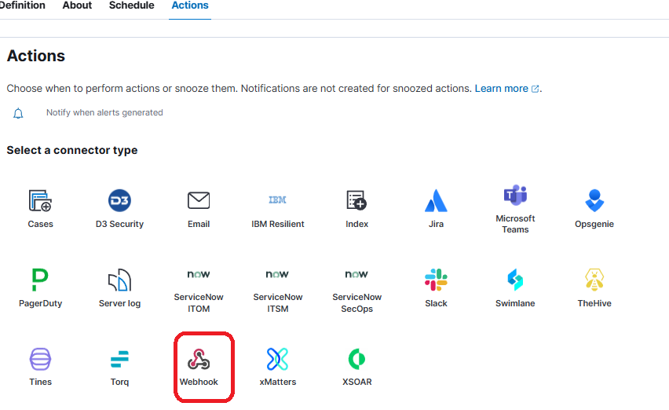
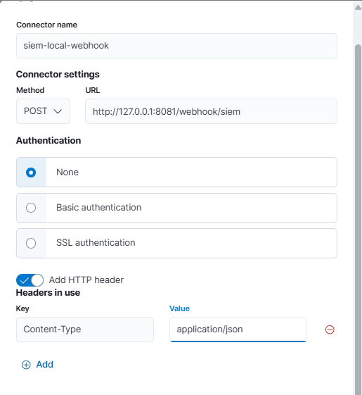

# Kibana에서 SIEM 탐지 규칙과 경보 전송 설정하기

[Filebeat 실습](../06_1009_observability/6.filebeat.md)에서 로그를 수집하고 Kibana 차트로 응답 코드와 로그인 실패 횟수를 확인했습니다. 이제 같은 IP와 계정의 로그인 실패가 일정 횟수를 넘으면 SIEM이 경보를 만들도록 설정합니다. 경보가 생성되는 것을 먼저 확인한 뒤 Webhook으로 전달합니다.

Kibana에서 탐지 규칙·Security Alerts·Webhook Connector·Actions를 설정합니다. 경보를 받을 대응 앱과 계정 차단을 수행할 인증 앱은 [인증 앱 실습](2.auth-app.md)에서 실행합니다.

실습을 시작할 때 Kibana 암호화 키를 설정하고 재시작한 뒤 Trial·권한을 확인합니다. 현재 시각의 샘플 로그를 추가해 Filebeat 수집을 확인하고, 탐지 규칙을 만듭니다. 경보가 생성되면 수신 앱과 Connector·Action을 연결합니다.


실습 준비에서 30일 무료 Trial을 활성화하고, 유효기간 동안 유지합니다. 실습 후 라이선스 확인과 만료 후 사용 범위는 9절을 참고합니다.

앞에서 IP별 로그인 실패 횟수를 차트로 봤다면, 이번에는 “같은 IP와 계정에서 최근 6분 동안 10회 이상 실패”라는 기준을 규칙으로 저장합니다.

이 자료의 `cd`, `ls`, `pwd`, `uv` 명령은 **Windows PowerShell / macOS 터미널 공통**입니다. **로그 생성기와 앱은 `2609_kookmin_rag` 저장소 루트에서**, **Filebeat는 설치 폴더에서** 실행합니다. 경로는 `/`로 표기하며, 운영체제별 절대 경로 예시는 [Filebeat 자료의 경로·명령 안내](../06_1009_observability/6.filebeat.md)를 참고합니다.

저장소의 폴더 구조는 다음과 같습니다.

```text
2609_kookmin_rag/
├── 06_1009_observability/
│   ├── generate_sample_logs.py
│   └── logs/
└── 07_1016_SIEM/
    ├── auth_app.py
    └── soar_app.py
```

`2609_kookmin_rag` 폴더에서 터미널을 열고 로그 생성기의 위치를 확인합니다.

```shell
pwd
ls ./06_1009_observability
```

## 실습 준비: Kibana 암호화 키 설정

`xpack.encryptedSavedObjects.encryptionKey`는 탐지 규칙과 액션에 저장되는 민감한 정보를 암호화하는 키입니다. **로컬 설치한 Kibana 8.19에서 SIEM 탐지 기능을 사용하기 위한 필수 설정**이므로, 탐지 규칙을 만들기 전에 키를 설정 파일에 저장하고 Kibana를 재시작합니다. [Elastic Security 8.19 탐지 기능의 사전 요건](https://www.elastic.co/guide/en/security/8.19/detections-permissions-section.html)

**① 기존 설정 확인**

Kibana 설치 폴더의 `config/kibana.yml`을 열고 `xpack.encryptedSavedObjects.encryptionKey`를 확인합니다. `xpack.encryptedSavedObjects:` 아래에 `encryptionKey:`를 적은 중첩 형태도 같은 설정입니다. **이미 값이 설정되어 있으면 그 값을 유지하고 다음 Trial·권한 확인으로 진행합니다.** 설정이 없으면 아래 순서로 추가합니다.

**② 암호화 키 생성**

Kibana 설치 폴더의 새 터미널에서 생성 명령을 실행합니다.

Windows PowerShell:

```powershell
cd E:/app/elk/kibana-8.19.21
./bin/kibana-encryption-keys.bat generate
```

macOS는 Kibana 압축을 푼 설치 폴더에서 실행합니다.

```sh
./bin/kibana-encryption-keys generate
```

**③ config/kibana.yml에 저장**

명령이 출력한 설정 중 **`xpack.encryptedSavedObjects.encryptionKey:`로 시작하는 행 전체**를 복사해 `config/kibana.yml`에 추가하고 저장합니다. 생성 명령은 키를 터미널에 출력하며, 설정 파일에는 직접 붙여 넣습니다.

**④ Kibana 재시작**

Kibana를 실행 중인 터미널에서 `Ctrl+C`로 종료합니다. Kibana 설치 폴더에서 다시 실행합니다.

Windows PowerShell:

```powershell
./bin/kibana.bat
```

macOS:

```sh
./bin/kibana
```

브라우저에서 Kibana에 다시 접속한 뒤 다음 Trial·권한 확인으로 이어갑니다. [암호화 키 생성 명령](https://www.elastic.co/guide/en/kibana/8.19/kibana-encryption-keys.html), [저장된 객체의 암호화](https://www.elastic.co/guide/en/kibana/8.19/xpack-security-secure-saved-objects.html)

## 실습 준비: Trial 라이선스 활성화

Kibana 8.19의 **Webhook Connector는 Basic에서 사용할 수 없고 Gold 이상이 필요**합니다. 이번 실습에서는 로컬 설치 환경의 **30일 무료 Trial**을 활성화해 경보 전송을 시연합니다. 암호화 키 설정을 마친 뒤 Trial과 계정 권한을 확인하고, 로그 수집·규칙 생성·Webhook 연결을 진행합니다.

실습 기간에는 Trial을 유지합니다. 라이선스와 만료일 확인은 9절을 참고합니다.

### 현재 라이선스 확인

Kibana의 **Dev Tools → Console**에서 현재 라이선스를 확인합니다.

```http
GET /_license
```

유효한 Trial 또는 Webhook 지원 구독이 적용되어 있으면 아래 **계정 권한과 Kibana 설정 확인**으로 진행합니다. Basic 상태이면 다음 단계에서 Trial을 활성화합니다.

### Trial 활성화 가능 여부 확인

Kibana의 **Dev Tools → Console**에서 다음 요청을 실행합니다.

```http
GET /_license/trial_status
```

응답의 `eligible_to_start_trial`이 `true`이면 Trial을 활성화합니다. Trial은 **같은 메이저 버전에서 한 번** 활성화할 수 있습니다. `false`이고 현재 Basic 상태라면 2절의 Security Alerts 확인까지 진행합니다. Webhook 연결은 유효한 Trial 또는 지원 구독이 적용된 환경에서 진행합니다. [Trial 상태 확인 API](https://www.elastic.co/guide/en/elasticsearch/reference/8.19/get-trial-status.html)

### Trial 활성화와 완료 확인

1. **Stack Management → License Management**를 엽니다.
2. **Start trial**을 누르고 안내와 약관을 확인한 뒤 **Start my trial**로 활성화합니다.
3. 라이선스 유형과 만료일을 확인합니다. 라이선스 변경에는 Elasticsearch 재시작이 필요하지 않습니다.

UI 대신 Dev Tools에서 활성화하려면 다음 요청을 실행합니다. 두 방법 중 하나만 사용합니다.

```http
POST /_license/start_trial?acknowledge=true
```

다음 응답이면 활성화가 완료된 것입니다.

```json
{
  "trial_was_started": true,
  "acknowledged": true
}
```

현재 라이선스를 확인합니다.

```http
GET /_license
```

`license.type`이 `trial`, `license.status`가 `active`인지 확인하고 아래 계정 권한과 Kibana 설정을 확인한 뒤 Filebeat 실행으로 진행합니다. [Trial 시작 API](https://www.elastic.co/guide/en/elasticsearch/reference/8.19/start-trial.html)

### 계정 권한과 Kibana 설정 확인

라이선스 변경에는 `manage` 클러스터 권한이 필요합니다. 이번 실습의 `elastic` 계정을 사용할 수 있습니다. Actions 등록에는 `Actions and Connectors` 기능의 `All` 권한도 필요합니다.

- [Elastic Security 8.19 Rule actions](https://www.elastic.co/guide/en/security/8.19/rules-ui-create.html#rule-actions)
- [Kibana 8.19 Alerting and action settings](https://www.elastic.co/guide/en/kibana/8.19/alert-action-settings-kb.html)

## 실습 준비: Filebeat 실행과 최신 샘플 로그 수집

탐지 규칙은 실행 시점을 기준으로 최근 6분의 로그를 조회합니다. **오늘 실습에 사용할 로그를 현재 시각으로 추가**하고 Filebeat가 Elasticsearch로 전송하도록 합니다.

### 준비 1. Filebeat 실행

Filebeat가 이미 실행 중이면 해당 터미널을 유지하고 준비 2로 진행합니다.

Elasticsearch와 Kibana를 실행한 상태에서 **Filebeat 전용 터미널**을 엽니다. 지난 Filebeat 실습에서 `filebeat.yml`과 Nginx 모듈을 설정한 설치 폴더로 이동합니다.

Windows PowerShell의 설치 경로 예시입니다.

```powershell
cd E:/app/elk/filebeat-8.19.21-windows-x86_64
```

macOS는 Filebeat 압축을 풀고 설정했던 폴더로 이동합니다. 아래 명령은 Windows PowerShell·macOS 터미널 공통이며, **Filebeat 설치 폴더**에서 실행합니다.

현재 위치와 설정 파일을 확인합니다.

```shell
pwd
ls ./filebeat.yml
```

설정 문법과 Elasticsearch 연결을 확인합니다.

```shell
./filebeat test config -e
./filebeat test output -e
```

설정 검사에서 `Config OK`, 출력 연결 검사에서 연결 성공을 확인한 뒤 수집을 시작합니다.

```shell
./filebeat -e
```

`-e`는 Filebeat 실행 로그를 현재 터미널에 출력합니다. Nginx 모듈의 `Enabled modules/filesets: nginx (access)`와 파일·인증·전송 오류 여부를 확인합니다. **이 터미널은 경보 전송과 계정 차단 실습이 끝날 때까지 켜 둡니다.** 종료할 때는 `Ctrl+C`를 누릅니다.

### 준비 2. 최신 샘플 로그 추가

`2609_kookmin_rag` 저장소 루트의 새 터미널에서 다음 명령을 실행합니다. Windows PowerShell과 macOS 터미널에서 같은 명령을 사용합니다.

```shell
uv run --no-project ./06_1009_observability/generate_sample_logs.py --scenario siem --minutes 1 --append --output-dir ./06_1009_observability/logs
```

`--minutes 1`은 실행 시각 기준 최근 1분의 로그를 만들고, `--append`는 기존 `spring.log`·`nginx.log` 뒤에 내용을 추가합니다. Filebeat는 읽던 위치 이후에 추가된 내용을 수집합니다. 출력 폴더는 기존 Filebeat 설정의 로그 경로와 맞춥니다.

### 준비 3. 수집 결과 확인

Kibana **Discover**에서 `filebeat-*`와 시간 범위 `Last 15 minutes`를 선택하고 새로 고침합니다. Spring 로그의 `@timestamp`가 방금 생성한 시각인지 확인하고, `198.51.100.23 / admin`의 로그인 실패 기록이 조회되면 규칙 생성으로 진행합니다.

## 1. 반복 로그인 실패 탐지 규칙 생성

Kibana에서 **Security → Rules → Detection rules (SIEM) → Create new rule**을 열고 규칙 유형을 **Threshold**로 선택합니다. 이미 같은 규칙을 만들었다면 편집 화면에서 설정을 확인합니다.

### 1.1 탐지 조건 설정

화면 위에서 아래로 **Index patterns → Custom query → Group by·Threshold** 순서로 설정합니다.



**① Index patterns**

상단에서 **Index Patterns** 탭을 선택합니다. 기존 패턴은 항목 옆의 `×`로 지우고, `filebeat-*`를 입력한 뒤 `Enter`를 눌러 항목으로 추가합니다.

**② Custom query**

검색창에 다음 KQL을 붙여 넣습니다. Spring 로그 중 인증 실패 이벤트를 탐지 대상으로 선택합니다.

```text
event.dataset: "spring.application" and event.category: "authentication" and event.outcome: "failure"
```

**③ Group by**

드롭다운에서 `source.ip`를 선택한 뒤 `user.name`도 추가합니다. 스크린샷처럼 **두 필드가 각각 하나의 항목으로 표시**되는지 확인합니다. 같은 IP와 계정 조합별로 실패 횟수를 셉니다.

**④ Threshold**

Group by 오른쪽의 **Threshold** 입력란에 `10`을 넣습니다. 같은 IP·계정 조합의 로그인 실패가 10건 이상이면 경보 조건에 해당합니다.

이 화면에서 다음 네 항목을 확인한 뒤 **Continue**를 누릅니다.

| 화면 항목 | 확인할 값 |
|---|---|
| Index patterns | `filebeat-*` 항목 1개 |
| Custom query | 위 KQL 전체 |
| Group by | `source.ip`, `user.name` 항목 2개 |
| Threshold | `10` |

### 1.2 규칙 기본 정보 설정

**About rule** 화면에서 이름·설명·기본 심각도를 설정합니다.



| 화면 항목 | 설정 |
|---|---|
| Name | `반복 로그인 실패 탐지` |
| Description | `반복 로그인 실패 탐지` |
| Default severity | `High` |

입력을 마치면 **Continue**를 누릅니다.

### 1.3 실행 주기 설정

**Schedule rule** 화면에서 실행 주기와 추가 조회 시간을 설정합니다. 각 항목은 왼쪽에 숫자를 입력하고 오른쪽 드롭다운에서 단위를 선택합니다.



| 화면 항목 | 숫자 | 단위 |
|---|---:|---|
| Runs every | `1` | `Minutes` |
| Additional look-back time | `5` | `Minutes` |

같은 IP와 계정의 로그인 실패가 최근 6분 동안 10건 이상이면 경보를 생성합니다. `198.51.100.23 / admin`의 로그인 실패는 기본 1,000건 생성 시 59건이며, Filebeat 자료의 `--count 2000` 예시에서는 122건입니다. 두 로그가 같은 요청을 기록하므로 Spring 로그만 집계합니다.

### 1.4 규칙 저장·활성화

**Continue**로 **Actions** 화면에 진입하고, 액션을 비워 둔 채 규칙을 저장·활성화합니다. Security Alerts에서 탐지 결과를 확인한 뒤 4절부터 Webhook 전송을 연결합니다.

## 2. Security Alerts에서 경보 확인

규칙을 저장·활성화한 직후, Filebeat가 실행 중인 상태에서 아래 명령으로 최신 로그를 한 번 더 추가합니다. 규칙 설정에 걸린 시간에 맞춰 조회 대상도 현재 시각으로 갱신합니다. 강의 프로젝트 폴더의 새 터미널에서 실행합니다.

```bash
uv run --no-project ./06_1009_observability/generate_sample_logs.py --scenario siem --minutes 1 --append --output-dir ./06_1009_observability/logs
```

Discover에서 새 로그가 수집된 것을 확인합니다. Kibana의 **Security Alerts**에서 시간 범위를 `Last 15 minutes`로 설정하고 규칙 이름 `반복 로그인 실패 탐지`로 필터링합니다. 규칙의 다음 실행 후 경보가 표시되는지 확인합니다.

경보 상세에서 규칙 이름과 `source.ip`, `user.name`, `kibana.alert.threshold_result.count`를 확인합니다. Threshold 경보는 집계 결과로 만든 경보이므로 Group by로 사용한 IP와 계정, 임계치를 넘은 횟수를 중심으로 봅니다.

경보가 보이면 로그 수집 → 규칙 실행 → 이상 행동 탐지까지 확인한 것입니다. 경보가 없으면 규칙의 실행 상태, `filebeat-*`의 최근 데이터, 로그인 실패 필드를 먼저 확인합니다. Filebeat 수집 지연과 1분 실행 주기에 따라 시간이 걸릴 수 있습니다.

이 단계는 Security Alerts 화면까지 확인합니다. 다음 단계에서 생성된 경보를 외부 프로그램에 전달합니다.

## 3. Webhook 수신 앱 준비

[인증 앱 실습의 1~2절](2.auth-app.md#1-앱-실행)에 따라 인증 앱과 대응 앱을 실행합니다. 대응 앱의 `/health`·경보 수신 응답과 인증 앱의 로그인 성공을 확인합니다. 두 앱의 터미널을 유지한 상태에서 아래 Connector 설정으로 이어갑니다.

## 4. Webhook Connector 등록

### 4.1 Actions에서 Webhook 선택

**Security → Rules → Detection rules (SIEM)**에서 `반복 로그인 실패 탐지` 규칙을 열고 편집 화면의 **Actions** 탭으로 이동합니다. **Select a connector type**에서 **Webhook**을 선택합니다.



### 4.2 Connector 설정

Webhook 액션의 커넥터 선택란에서 새 커넥터 추가 화면을 엽니다. 위에서 아래로 이름, 요청 방식·주소, 인증 방식, HTTP 헤더를 입력합니다.



| 항목 | 입력값 |
|---|---|
| Connector name | `siem-local-webhook` |
| Method | `POST` |
| URL | `http://127.0.0.1:8081/webhook/siem` |
| Authentication | `None` |
| Add HTTP header | 켜기 |
| Key | `Content-Type` |
| Value | `application/json` |

**Add HTTP header**를 켠 뒤 표시되는 **Key**와 **Value**에 헤더를 입력하고 커넥터를 저장합니다.

저장하면 커넥터가 등록됩니다. 인증 없음 설정은 같은 컴퓨터의 루프백 주소에 한정한 실습용입니다.

커넥터는 전송 주소와 인증 설정을 저장합니다. 실제로 어떤 경보 내용을 전송할지는 다음 단계의 규칙 Actions에서 지정합니다.

## 5. Connector 연결 테스트

저장한 커넥터의 편집 화면에서 연결을 테스트합니다.

1. 커넥터 설정 창에서 저장을 마치고 창을 닫습니다.
2. Kibana 메뉴에서 **Stack Management → Connectors**를 엽니다.
3. 커넥터 목록에서 **siem-local-webhook 이름**을 클릭해 편집 패널을 엽니다.
4. 열린 커넥터 편집 패널의 **Test** 탭을 선택합니다.

테스트 화면의 **Body**에 다음 JSON을 입력하고 **Run**을 실행합니다. [Elastic 8.19 Webhook 커넥터 테스트](https://www.elastic.co/guide/en/kibana/8.19/webhook-action-type.html)

```json
{
  "alert_id": "connector-test-001",
  "rule_id": "manual-test",
  "rule_name": "Webhook 연결 테스트",
  "severity": "low",
  "action_time": "manual-test"
}
```

커넥터 테스트로 Kibana의 HTTP 전송과 대응 앱의 수신을 확인합니다. 대응 앱 터미널에 `SIEM webhook received`와 JSON이 출력되고 커넥터 테스트가 성공하는지 확인합니다.

## 6. 기존 SIEM 규칙의 Actions에 연결

**Security → Rules → Detection rules (SIEM)**에서 `반복 로그인 실패 탐지` 규칙을 열고 **Edit → Actions**로 이동합니다.

1. **Select a connector type**에서 **Webhook**을 선택합니다.
2. 커넥터로 저장한 **siem-local-webhook**을 선택합니다.
3. Action frequency를 **For each alert**로 설정합니다.
4. 추가 KQL 및 전송 시간 조건은 첫 실습에서는 설정하지 않습니다.
5. Body에 다음 JSON을 입력합니다.

```json
{
  "alert_id": "{{alert.id}}",
  "rule_id": "{{context.rule.id}}",
  "rule_name": "{{context.rule.name}}",
  "severity": "{{context.rule.severity}}",
  "action_time": "{{date}}"
}
```

`{{...}}`는 Kibana가 전송 시 실제 값으로 바꾸는 Mustache 변수입니다. `alert.id`는 **For each alert** 빈도에서 제공되므로 이 Body를 사용할 때 해당 빈도를 유지합니다. `date`는 액션이 예약된 시각이며 원본 로그의 발생 시각과 구분합니다.

Actions에 커넥터와 전송 본문을 지정한 뒤 규칙 변경을 저장하고 규칙을 활성화합니다.

## 7. 새 경보의 Webhook 수신 확인

Actions를 저장·활성화한 뒤 현재 시각의 로그를 다시 추가합니다. Filebeat 수집과 규칙의 다음 실행을 거쳐 새 경보가 대응 앱에 전송되는지 확인합니다.

Filebeat와 대응 앱이 실행 중인지 확인한 뒤 강의 프로젝트 폴더의 새 터미널에서 최근 공격 로그를 추가합니다.

```bash
uv run --no-project ./06_1009_observability/generate_sample_logs.py --scenario siem --minutes 1 --append --output-dir ./06_1009_observability/logs
```

규칙의 다음 실행 후 다음 두 가지를 확인합니다.

- **Security Alerts**: 반복 로그인 실패 경보가 생성됨
- **대응 앱 터미널**: 실제 경보 ID와 규칙 이름이 포함된 JSON이 출력됨

규칙은 위에서 설정한 1분 간격으로 실행합니다. Filebeat 수집 지연과 규칙 실행 주기에 따라 수신까지 시간이 걸릴 수 있습니다.

## 8. 실패 지점 구분

| 증상 | 확인할 항목 |
|---|---|
| Webhook 유형 비활성화 | [실습 준비의 Trial 활성화](#실습-준비-trial-라이선스-활성화)와 현재 라이선스 확인 |
| Connector 테스트 실패 | 대응 앱 실행 여부, URL, 포트, Kibana가 실행되는 컴퓨터 |
| Connector 테스트 성공, SIEM 경보 없음 | Filebeat 수집, 규칙 조건, 최근 조회 시간 범위 |
| SIEM 경보 있음, Webhook 수신 없음 | 규칙 Actions 저장 여부, 커넥터 선택, 전송 조건, 규칙 실행 로그 |
| `alert_id`가 비어 있음 | Action frequency가 `For each alert`인지 확인 |

등록과 JSON 수신을 확인한 뒤 [인증 앱](2.auth-app.md)에서 계정 차단·복구를 연결합니다.

## 9. 실습 마무리: Trial 유지와 라이선스 확인

실습 후에는 Trial과 탐지 규칙·Connector 설정을 유지합니다. 10월 23일 종합 실습에서도 같은 설정을 사용해 Webhook 전송과 계정 차단·복구를 확인합니다.

**Stack Management → License Management**에서 현재 라이선스 유형과 만료일을 확인합니다. Dev Tools에서도 조회할 수 있습니다.

```http
GET /_license
```

Trial은 30일 동안 유료 기능을 체험하는 라이선스입니다. 기간이 만료되면 Basic으로 전환되며, Filebeat 수집·검색·Discover·Lens 등 Basic 기능을 계속 사용합니다. Webhook 전송에는 유효한 Trial 또는 지원 구독이 필요합니다. [라이선스 관리](https://www.elastic.co/guide/en/kibana/8.19/managing-licenses.html)

Trial은 같은 메이저 버전에서 한 번 활성화할 수 있습니다. 추가 체험 기간은 [Trial 연장 신청](https://www.elastic.co/trialextension)으로 요청할 수 있습니다. [Trial 시작 API](https://www.elastic.co/guide/en/elasticsearch/reference/8.19/start-trial.html)

Basic 상태에서 유료 기능을 사용하려면 유효한 유료 라이선스를 **Stack Management → License Management**에서 등록합니다. [라이선스 적용](https://www.elastic.co/guide/en/kibana/8.19/managing-licenses.html#update-license)

- [Webhook connector and action 8.19](https://www.elastic.co/guide/en/kibana/8.19/webhook-action-type.html)
- [SIEM 액션 변수 및 설정 8.19](https://www.elastic.co/guide/en/security/8.19/rules-ui-create.html)
