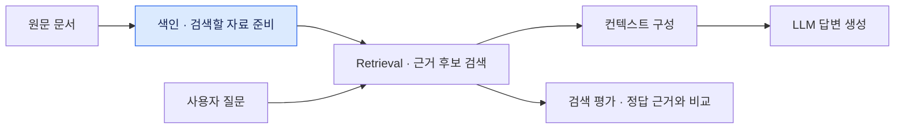

# 10주차 · Retrieval 개론

11월 6일 첫 교시 · 개론 설명 약 10분

RAG에서 Retrieval은 **질문에 답할 근거를 문서에서 찾는 단계**입니다. 이번 주에는 검색에 쓸 색인을 만들고, 이후 수업에서 이 색인으로 검색과 평가를 진행합니다.

## 1. RAG 전체 흐름에서 검색의 위치

[첫 RAG 소개 자료](../02_0911_RAG_구조와_실습환경/0.RAG소개.pptx)의 「모던 RAG 아키텍처」를 바탕으로 검색 주변을 확대해 봅니다.

색인은 질문이 들어오기 전에 준비합니다. 질문이 들어오면 Retrieval이 색인에서 근거 후보를 찾습니다. 검색 평가는 그 후보에 필요한 근거가 들어왔는지 확인하는 별도의 실습입니다.

## 2. 질문 하나로 보는 색인·검색·평가

> **질문**　이미 신청한 강의를 다른 강의로 바꿀 수 있나요?
>
> **근거 문장**　수강 정정 기간에는 신청 과목을 변경할 수 있다.
>
> **출처**　「수강 정정 안내」(가상 실습 문서)

| 단계 | 이 예시에서 하는 일 |
| --- | --- |
| **색인** | 안내문을 청크로 나누고, 근거 문장이 담긴 청크의 텍스트·임베딩 벡터·출처를 Elasticsearch에 저장합니다. |
| **검색** | 같은 질문을 BM25와 벡터 검색으로 각각 실행합니다. 두 방식이 반환한 Top 10에서 「수강 정정 안내」가 몇 위인지 확인합니다. |
| **평가** | 미리 지정한 정답 문서와 근거 문장을 검색 결과에 대조합니다. 정답 문서가 나왔더라도, 함께 반환된 청크에 답변에 필요한 문장이 있는지 따로 확인합니다. |

## 3. 10~13주차 실습 흐름

| 주차 | 주제 | 그날 확인할 것 |
| --- | --- | --- |
| **10주차** | Retrieval 개론과 문서 색인 | 색인된 청크 한 건에 텍스트·벡터·출처가 들어갔는지 확인합니다. |
| **11주차** | BM25와 벡터 검색 | 같은 질문으로 두 Top 10을 비교합니다. |
| **12주차** | 하이브리드 검색과 RRF | 두 순위를 합치고 가중치를 바꿨을 때 결과가 어떻게 달라지는지 확인합니다. |
| **13주차** | 검색 품질 평가 | 공통 정답지로 검색 결과를 비교하고 실패한 질문을 분석합니다. |

## 4. 오늘 실습에서 확인할 것

색인된 청크 한 건을 열고 다음 세 가지를 확인합니다.

- **텍스트** · 원문에서 어떤 내용이 검색 단위로 저장되었나요?
- **벡터** · 같은 청크의 임베딩이 저장되었나요?
- **출처** · 이 청크가 어느 문서에서 왔는지 확인할 수 있나요?

세 가지가 확인되면 색인 실습을 마칩니다. 다음 주에는 같은 색인에 질문을 보내 실제 검색 결과를 비교합니다.

### 이어서 해볼 실습 · 청크 크기 비교

같은 원문을 **서로 다른 두 청크 크기**로 나눠 봅니다. 설정마다 생성된 청크 수를 기록하고, 수강 정정 예시의 근거 문장이 어느 청크에 들어갔는지 찾아봅니다. 문장이나 앞뒤 맥락이 청크 경계에서 잘렸다면, 그 상태로 검색 결과에 나왔을 때 질문에 답할 수 있을지 비교합니다.
