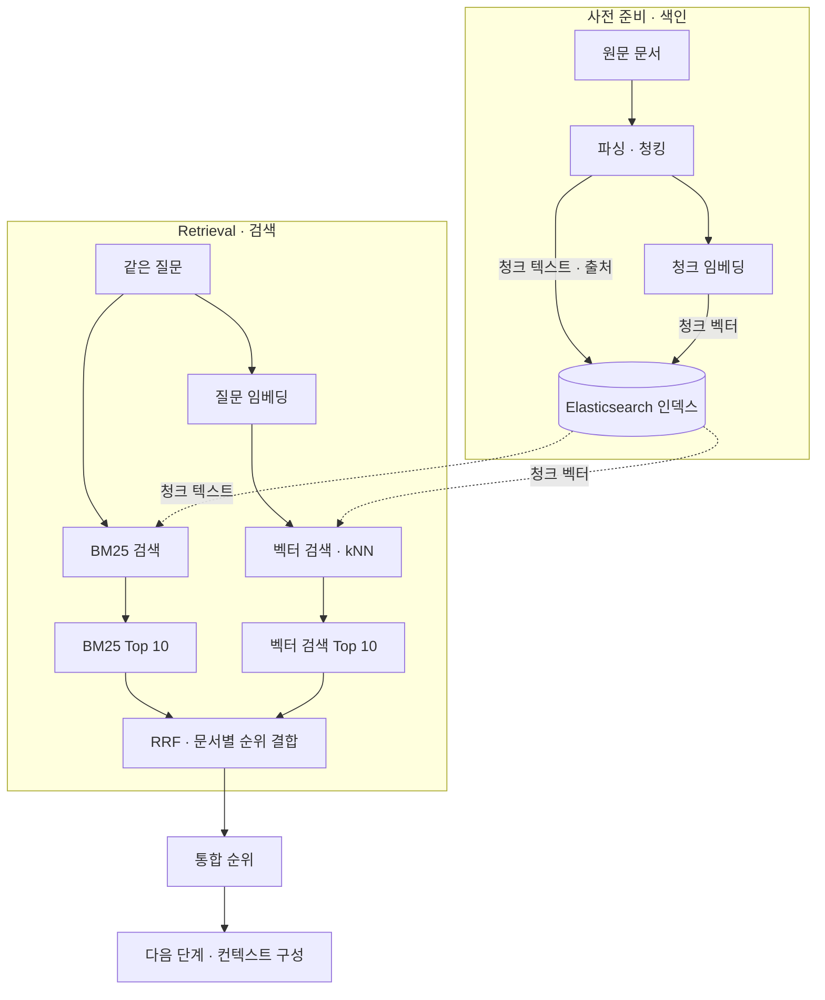

# 하이브리드 검색 실습 · BM25, 벡터 검색, RRF

같은 질문을 BM25와 벡터 검색으로 실행하고, 두 결과에서 **답변에 필요한 근거를 몇 위에서 찾았는지** 확인합니다. 이어서 기본 RRF와 가중치 RRF로 두 순위를 합쳐 봅니다.

## 1. RAG에서 Retrieval이 하는 일

[첫 RAG 소개 자료](../02_0911_RAG_구조와_실습환경/0.RAG소개.pptx)의 **「모던 RAG 아키텍처」**에서 검색 구간을 확대합니다. 색인 단계에서 검색할 자료를 준비하고, 질문이 들어오면 색인에서 관련 청크를 찾습니다.

청크와 질문은 같은 임베딩 모델로 벡터화합니다. 실습에서는 **두 Top 10 목록을 먼저 비교한 뒤** RRF로 합칩니다.

## 2. 같은 질문, 다른 순위

> **질문**　이미 신청한 강의를 다른 강의로 바꿀 수 있나요?
>
> **근거 문장**　수강 정정 기간에는 신청 과목을 변경할 수 있다.

위 문장은 가상의 학사 안내에서 가져온 실습 예시입니다.

| 검색 방식 | 순위를 정하는 기준 | 유리할 수 있는 질문 |
| --- | --- | --- |
| **BM25** | 질문과 문서에 일치하는 검색어를 바탕으로 점수를 매깁니다. | `수강 정정`, 과목 코드, 조항 번호처럼 정확한 용어가 들어간 질문 |
| **벡터 검색** | 질문 벡터와 청크 벡터의 유사도를 바탕으로 순위를 매깁니다. | `강의를 바꾸다`와 `과목을 변경하다`처럼 같은 뜻을 다르게 표현한 질문 |

## 3. 기본 RRF

두 Top 10 목록에서 같은 문서 ID의 순위를 모읍니다. 각 목록에서 순위를 **`1 / (60 + 순위)`**로 바꿔 더하고, 합계가 높은 순으로 정렬합니다. 한 목록에 문서가 없으면 그 목록의 기여점은 **0**입니다.

`60`은 Elasticsearch의 기본 순위 상수(`rank_constant`)입니다. 아래 순위는 예시로 뽑은 다섯 문서 사이의 순위입니다. [Elasticsearch RRF 문서](https://www.elastic.co/guide/en/elasticsearch/reference/8.19/rrf.html)

| 문서 | BM25 등수 | 벡터 등수 | RRF 점수 수식 | RRF 점수 | RRF 등수 |
| --- | ---: | ---: | --- | ---: | ---: |
| A | 1위 | Top 10 밖 | `1/(60+1) + 0` | 0.016393 | 4위 |
| B | 2위 | 3위 | `1/(60+2) + 1/(60+3)` | 0.032002 | 2위 |
| C | 3위 | 1위 | `1/(60+3) + 1/(60+1)` | **0.032266** | **1위** |
| D | Top 10 밖 | 2위 | `0 + 1/(60+2)` | 0.016129 | 5위 |
| E | 4위 | 4위 | `1/(60+4) + 1/(60+4)` | 0.031250 | 3위 |

**생각해 볼 질문** · 두 목록에서 모두 4위인 E는 왜 BM25에서 1위인 A보다 앞설까요?

## 4. 가중치 RRF

목록별 기여점에 검색 방식의 가중치를 곱해 더합니다. 같은 다섯 문서에 **BM25 0.75, 벡터 검색 0.25**를 적용하면, BM25에서 한 계단 앞선 **B가 C를 추월**합니다. [Elasticsearch 가중치 RRF 설명](https://www.elastic.co/search-labs/blog/weighted-reciprocal-rank-fusion-rrf/)

| 문서 | BM25 등수 | 벡터 등수 | 가중 RRF 점수 수식 | 가중 RRF 점수 | RRF 등수 |
| --- | ---: | ---: | --- | ---: | ---: |
| A | 1위 | Top 10 밖 | `0.75/(60+1) + 0` | 0.012295 | 4위 |
| B | 2위 | 3위 | `0.75/(60+2) + 0.25/(60+3)` | **0.016065** | **1위** |
| C | 3위 | 1위 | `0.75/(60+3) + 0.25/(60+1)` | 0.016003 | 2위 |
| D | Top 10 밖 | 2위 | `0 + 0.25/(60+2)` | 0.004032 | 5위 |
| E | 4위 | 4위 | `0.75/(60+4) + 0.25/(60+4)` | 0.015625 | 3위 |

- **BM25 비중을 높여 볼 때** · 과목 코드나 규정 조항 번호처럼 정확한 일치가 중요한 질문이 많을 때
- **벡터 검색 비중을 높여 볼 때** · 학생이 묻는 표현과 문서의 공식 용어가 자주 다를 때

## 5. 실습 · Top 10에서 근거 찾기

1. 검색 전에 질문에 답할 **정답 문서와 근거 문장**을 정합니다.
2. 같은 색인에서 각 질문을 **BM25와 벡터 검색으로 각각 실행**해 Top 10을 가져옵니다.
3. 정답 문서의 순위를 적습니다. 없으면 `Top 10 밖`으로 표시합니다. 정답 문서가 나왔으면 함께 나온 청크에 답변 근거가 있는지도 확인합니다.
4. 두 순위 목록을 기본 RRF와 가중치 RRF로 각각 합칩니다. 순위가 달라진 문서 한 건을 골라 두 검색에서 받은 기여점으로 설명합니다.

| 질문 | BM25 정답 순위 | 벡터 검색 정답 순위 | 기본 RRF 정답 순위 | 가중 RRF 정답 순위 | 검색된 근거 문장 |
| --- | --- | --- | --- | --- | --- |
| 수강 정정 기간에 신청 과목을 변경할 수 있나요? | | | | | |
| 이미 신청한 강의를 다른 강의로 바꿀 수 있나요? | | | | | |
