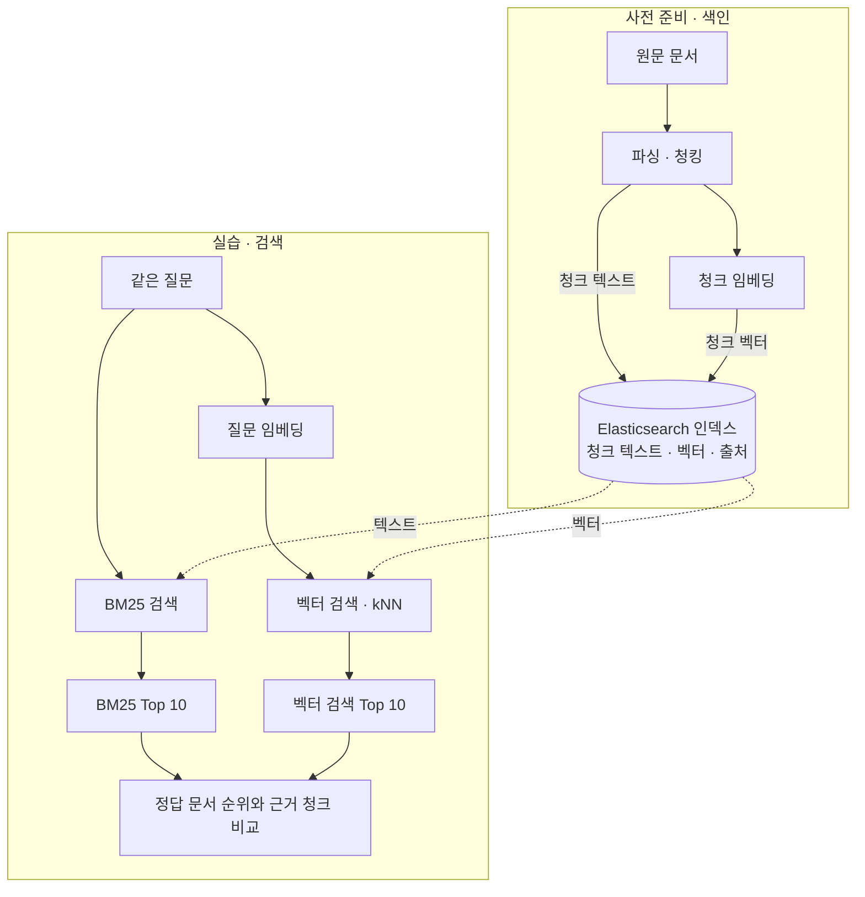

# Retrieval 실습 워크플로

같은 질문을 BM25와 벡터 검색으로 실행하고 각각 상위 10개 결과를 비교합니다.

청크와 질문은 같은 임베딩 모델로 벡터화합니다. 두 검색에서 색인과 질문을 고정하고 검색 방식만 바꿉니다.

검색 방식별로 정답 문서의 순위를 기록하고, 결과에 나온 청크에 답변 근거가 있는지 확인합니다. 상위 10개에 정답 문서가 없으면 `Top 10 밖`으로 기록합니다.
