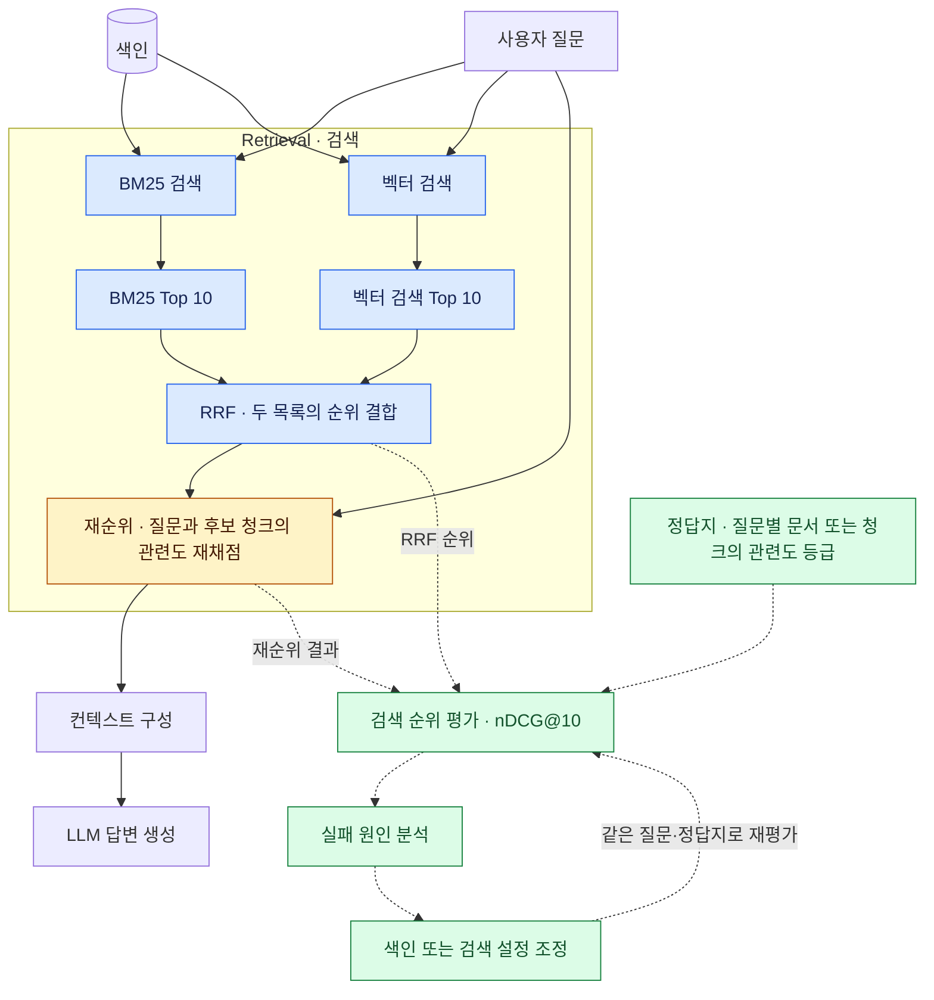

# 10주차 · Retrieval 개론

RAG에서 Retrieval은 **질문에 답할 근거를 문서에서 찾는 단계**입니다. 

## 1. RAG 전체 흐름에서 검색의 위치

첫 강의에서 본 「모던 RAG 아키텍처」의 검색과 재순위 구간을 확대하고, 검색 순위를 평가하는 흐름을 추가했습니다.

- **파란색 · 검색과 RRF**　BM25와 벡터 검색의 Top 10을 받아, 같은 문서 ID의 순위별 기여점을 합산합니다. 이 점수로 통합 후보 목록의 순서를 정합니다.
- **주황색 · 재순위(Rerank)**　재순위를 적용할 때는 RRF가 고른 상위 후보와 원래 질문을 재순위 모델에 전달합니다. 모델이 질문과 각 청크의 관련도를 다시 채점하면, 그 점수로 후보의 순서를 조정한 뒤 컨텍스트를 구성합니다.
- **초록색 · 검색 평가**　같은 질문과 관련도 정답지로 RRF 직후와 재순위 후의 Top 10을 비교합니다.

### 검색 순위는 어떻게 평가하나요?

질문마다 검색 결과와 같은 단위로 관련도를 매깁니다. 예를 들어 청크를 평가한다면 **2점**은 질문에 직접 답하는 청크, **1점**은 일부 도움이 되는 청크, **0점**은 관련 없는 청크입니다.

| 지표 | 확인하는 것 |
| --- | --- |
| **nDCG@10** | 관련도가 높은 결과가 앞에 배치됐는지 봅니다. 실제 Top 10의 점수를 정답지에서 관련도가 가장 높은 결과를 앞에 놓았을 때의 최대 점수로 나눕니다. |
| **MRR@10** | 첫 관련 결과가 얼마나 빨리 나오는지 봅니다. 첫 관련 결과가 2위면 그 질문은 `1/2`, Top 10에 없으면 `0`이고, 질문별 값을 평균합니다. |
| **Recall@10** | 정답지에 지정한 관련 결과 중 Top 10에서 찾은 비율입니다. 관련 청크가 4개이고 그중 3개를 찾았다면 `3/4`입니다. |

[Elasticsearch 검색 순위 평가 문서](https://www.elastic.co/guide/en/elasticsearch/reference/8.19/search-rank-eval.html)

#### 예시 · 같은 검색 결과를 세 지표로 보기

질문은 “이미 신청한 강의를 다른 강의로 바꿀 수 있나요?”입니다. 이 예시에서는 관련도 **1점 이상**을 관련 결과로 봅니다. 표에 생략한 Top 10 결과의 관련도는 0입니다.

| 검색 순위 | 청크 | 정답지 관련도 |
| ---: | --- | ---: |
| 1위 | 휴학 신청 안내 | 0 |
| 2위 | 수강 정정 기간과 변경 방법 | 2 |
| 3위 | 학사 일정에 나온 수강 정정 기간 | 1 |
| 4위 | 장학금 신청 안내 | 0 |
| 11위 | 신청 과목을 변경하는 절차 | 2 |

| 지표 | 이 질문의 계산 | 점수 |
| --- | --- | ---: |
| **DCG@10 · 실제 순위** | `0/log₂(2) + 2/log₂(3) + 1/log₂(4)` | **1.762** |
| **IDCG@10 · 이상적인 순위** | `2/log₂(2) + 2/log₂(3) + 1/log₂(4)` | **3.762** |
| **nDCG@10** | `DCG@10 ÷ IDCG@10 ≈ 1.762 ÷ 3.762` | **0.468** |
| **RR@10** | `1 ÷ 2` | **0.500** |
| **Recall@10** | `2 ÷ 3` | **0.667** |

평가 후에는 점수가 낮은 질문을 골라, 어느 단계에서 정답 청크가 빠지거나 뒤로 밀렸는지 확인합니다.

1. **BM25와 벡터 검색을 각각 확인합니다.** 두 Top 10에서 정답 청크가 나왔는지 보고, 나왔다면 순위와 점수를 기록합니다. BM25는 어떤 검색어가 제목·본문에 일치해 점수를 얻었는지 봅니다. 벡터 검색은 정답 청크가 질문과 얼마나 가깝게 계산됐는지 상위 오답 청크와 비교합니다. 점수는 각 검색 방식의 결과 목록 안에서 해석합니다.
2. **RRF와 재순위 결과를 차례로 확인합니다.** 개별 검색에서 찾은 정답 청크가 RRF로 합칠 때 밀렸는지, 재순위 모델을 적용한 뒤 밀렸는지 구분합니다.
3. **원인에 맞춰 설정 하나를 바꾸고 다시 평가합니다.** BM25의 분석기나 필드 가중치, 벡터 검색의 임베딩 입력이나 후보 수, RRF 가중치나 재순위 후보 수 중 원인에 맞는 하나를 바꿉니다. 같은 질문과 정답지로 다시 검색해 순위와 평가 점수를 비교합니다.

## 2. 질문 하나로 보는 색인·검색·평가

> **질문**　이미 신청한 강의를 다른 강의로 바꿀 수 있나요?
>
> **근거 문장**　수강 정정 기간에는 신청 과목을 변경할 수 있다.
>
> **출처**　「수강 정정 안내」

| 단계 | 프로세스 |
| --- | --- |
| **색인** | 안내문을 청크로 나누고, 근거 문장이 담긴 청크의 텍스트·임베딩 벡터·출처를 Elasticsearch에 저장합니다. |
| **검색** | 같은 질문을 BM25와 벡터 검색으로 각각 실행합니다. 두 방식이 반환한 Top 10에서 「수강 정정 안내」가 몇 위인지 확인합니다. |
| **평가** | 수강 정정에 직접 답하는 결과와 일부만 관련 있는 결과에 다른 등급을 줍니다. nDCG@10으로 직접 근거가 있는 결과가 앞에 배치됐는지 확인합니다. |
